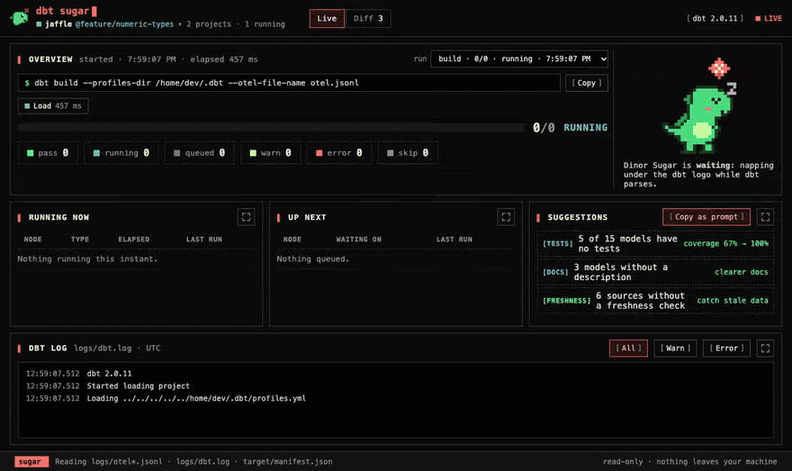

<p align="center">
  
</p>

<p align="center"><b>A live local page for your dbt v2 runs: what's running, what's next, what broke and how to fix it, plus what your branch really changes, in one CLI.</b></p>

<p align="center">
  <a href="https://github.com/datnguye/dbt-sugar/actions/workflows/ci.yml"></a>
  <a href="docs/spec.md"></a>
  <a href="https://github.com/datnguye/dbt-sugar/releases"></a>
  <a href="https://www.npmjs.com/package/dbt-sugar"></a>
  
  
  <a href="https://opensource.org/licenses/MIT"></a>
  <a href="https://nodejs.org"></a>
</p>

Run `sugar -- dbt build` and a page opens next to your terminal. The **Live** tab shows the phases dbt has finished, a progress bar, the nodes running right now (and whether they are slower than last time), what's queued and what each one waits on, which failure blocked what, the dbt log of that exact invocation, and a short list of fixes. **Dinor Sugar**, a pixel dinosaur, chases the dbt logo while things go well, sweats at warnings, panics when an error lets the logo escape, and catches it (sunglasses on) when everything is green. It cannot fix your SQL, but it does try.

When the PR gets big, the **Diff** tab compares your branch with its base from the manifests themselves: added, modified and removed nodes with the reason, a SQL diff, breaking changes (contracts, columns, incremental config) floated to the top, what sits downstream, a review checklist and the `dbt build --select …+` that rebuilds exactly that. No base artifacts yet? One click parses that commit in a throwaway git worktree. Your checkout never notices.

<p align="center">
  
</p>

## Why dbt sugar?

dbt v2 (Fusion) is fast, and its terminal output scrolls by just as fast. With hundreds of nodes, the questions are always the same: *what is it doing now*, *what is it stuck behind*, *will yesterday's failing model take half the DAG down again*, and *what does this branch actually change*. dbt sugar answers those from files dbt already writes (`logs/otel*.jsonl`, `logs/dbt.log`, `target/manifest.json`), with no API keys, no accounts and no setup.

## Install

```bash
npm install -g dbt-sugar
```

Requires Node.js 22+ and dbt v2 (Fusion).

## Quickstart

```bash
sugar -- dbt build --select +orders   # run dbt and watch it at http://127.0.0.1:4322
sugar                                  # watch runs started elsewhere in this project
sugar -d ./project_a -d ./project_b    # several projects; switch between them from the header
```

Sugar follows a run through dbt's OTel log, which dbt writes only when asked. `sugar -- dbt …` asks for you; for runs you start yourself, ask once in your shell profile:

```bash
export DBT_OTEL_FILE_NAME=otel.jsonl   # or per run: dbt build --otel-file-name otel.jsonl
```

A plain `dbt build` without it still lands in the log panel, and the page tells you it couldn't follow the rest. Running several dbt processes at once (hello, agents)? Give each its own `DBT_LOG_PATH` folder under `logs/`; `sugar -- dbt …` does that for you. The Diff tab needs whatever `dbt parse` needs (a profile), reusing the profiles dir and target of your last run. `sugar --help` lists every option.

Sugar never writes to your project. History and the last 10 invocations of each project live under `~/.dbt-sugar` (or `$DBT_SUGAR_HOME`), metadata and dbt's own artifacts only. Nothing leaves your machine.

The full behaviour and data sources live in the **[spec](docs/spec.md)**; how the pieces fit together, from `sugar` starting up to a Diff click in the page, is in **[architecture](docs/architecture.html)** (an animated page; open it in a browser).

## Contributing

Contributions are welcome: bugs, features, new suggestion rules, docs, typos. See the **[Contributing Guide](CONTRIBUTING.md)**. It's spec-first, and the guards are friendly but don't take bribes.

If dbt sugar saves you some scrolling, consider [buying me a coffee](https://www.buymeacoffee.com/datnguye).

<a href="https://www.buymeacoffee.com/datnguye"></a>

## License

[MIT](./LICENSE) © Dat Nguyen
