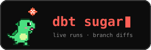

<p align="center">
  
</p>

<p align="center"><b>A live local page for dbt v2 runs: what's running, what's next, what to fix, and Dinor Sugar, a pixel dinosaur forever chasing the dbt logo.</b></p>

<p align="center">
  <a href="https://github.com/datnguye/dbt-sugar/actions/workflows/ci.yml"></a>
  <a href="docs/spec.md"></a>
  
  <a href="https://opensource.org/licenses/MIT"></a>
  <a href="https://nodejs.org"></a>
</p>

Run `sugar -- dbt build` and a page opens next to your terminal. It shows the phases dbt has finished, a `done/total` progress bar, the nodes running right now (and whether they are slower than last time), what's queued and what each one is waiting on, and a short list of suggestions to make the project healthier. Dinor Sugar, a pixel dinosaur, chases the dbt logo while things go well, sweats at warnings, panics when an error lets the logo escape, and catches it (sunglasses on) when everything is green. It cannot fix your SQL, but it does try.

Everything comes from files dbt v2 already writes: `logs/otel*.jsonl`, `logs/dbt.log` and `target/manifest.json`. No API keys, no accounts, nothing leaves your machine.

<p align="center">
  
</p>

## Why dbt sugar?

dbt v2 (Fusion) is fast, and its terminal output scrolls by just as fast. When a build has hundreds of nodes, the questions are always the same: *what is it doing now*, *what is it stuck behind*, *will that model that failed yesterday take half the DAG down with it again*, and *what should I fix first*. dbt sugar answers those from the OTel log, live, and remembers past runs in a small local DuckDB file so "slower than usual" and "flaky" actually mean something.

## Install

```bash
npm install -g dbt-sugar
```

Requires Node.js 22+ and dbt v2 (Fusion).

## Quickstart

```bash
sugar -- dbt build --select +orders   # run dbt and watch it at http://127.0.0.1:4322
sugar                                  # watch runs started elsewhere in this project
sugar -d ./project_a -d ./project_b    # several projects; switch between them from the header
```

Sugar follows a run live through dbt's OTel log, and dbt only writes it when asked. `sugar -- dbt …` asks for you. For runs you start yourself, ask once in your shell profile:

```bash
export DBT_OTEL_FILE_NAME=otel.jsonl   # or per run: dbt build --otel-file-name otel.jsonl
```

A plain `dbt build` without it still lands in the log panel, but not in the progress bar, Running now or Up next; the page says so instead of pretending nothing happened. Running several dbt processes at once (hello, agents)? Give each its own log folder, for example `DBT_LOG_PATH=logs/run-$$`, so their `dbt.log` lines don't interleave; `sugar -- dbt …` does this for you. Sugar reads `logs/` and its subfolders and shows each invocation separately.

History lives in `~/.dbt-sugar/history.duckdb` (or `$DBT_SUGAR_HOME`). It stores run and node metadata only, no SQL, no data. `sugar --help` lists every option.

## Review a branch: the Diff tab

Big PRs are where reviewers lose the plot. The **Diff** tab compares your branch's `target/manifest.json` with the one from `main` and shows what actually changed: added, modified and removed nodes with the reason (SQL, materialization, contract, columns and their types, dependencies, tests), a SQL diff, what sits downstream, a short review checklist, and the `dbt build --select …+` command that rebuilds exactly that.

The breaking stuff floats to the top: models removed while something still uses them, column changes on enforced contracts, incremental config changes that need a `--full-refresh`.

Pick the **base** branch (defaults to the repo's default branch, e.g. `origin/main`) and the **compare** side (defaults to your current branch's working tree) right on the page. If there are no dbt artifacts for that commit yet, the page shows the exact command and a **Generate** button: sugar checks the commit out into a temporary git worktree and runs `dbt parse --target-path ~/.dbt-sugar/base/<sha>/<project>` there, then removes the worktree. Artifacts are cached per commit, so it only happens once. Run the shown command yourself if you prefer; the page picks the result up either way.

It needs whatever `dbt parse` needs (a profile) and reuses your installed `dbt_packages`. The working-tree side is your `target/manifest.json`; if you've never parsed, the page offers Generate for that side too, writing only into sugar's cache (never your `target/` or `logs/`). Nothing has to have run: the Diff tab only needs git and a parse.

## Use it as a library

The page is one consumer. The same pieces are exported for hosts such as [Agent Cage](https://github.com/datnguye/agent-cage) that watch many dbt processes:

```js
import { createDbtSource, createSnapshotBuilder } from 'dbt-sugar';
import { mascotSvg } from 'dbt-sugar/mascot';

const source = createDbtSource({ projectDir: '/path/to/project' });
const builder = createSnapshotBuilder({ sources: [source], store: null });
const snapshot = await builder.build();
```

`store` is optional: pass `null` to skip history, the bundled DuckDB store (`createStore`), or anything with `saveRun`, `previousRun` and `stats`. The full behaviour lives in the **[spec](docs/spec.md)**; how the pieces fit together, from `sugar` starting up to a Diff click in the page, is in **[architecture](docs/architecture.html)** (an animated page; open it in a browser).

## Contributing

Bugs, ideas and new suggestion rules are welcome; see the **[Contributing Guide](CONTRIBUTING.md)** and the **[decision records](docs/decisions/README.md)**. `npm run verify` runs the same gates as CI: syntax and layering checks, unit and e2e tests at 100% coverage, and Playwright against a replay of a real jaffle-shop build (`npm run playground` to watch that replay yourself).

## License

[MIT](./LICENSE) © Dat Nguyen
